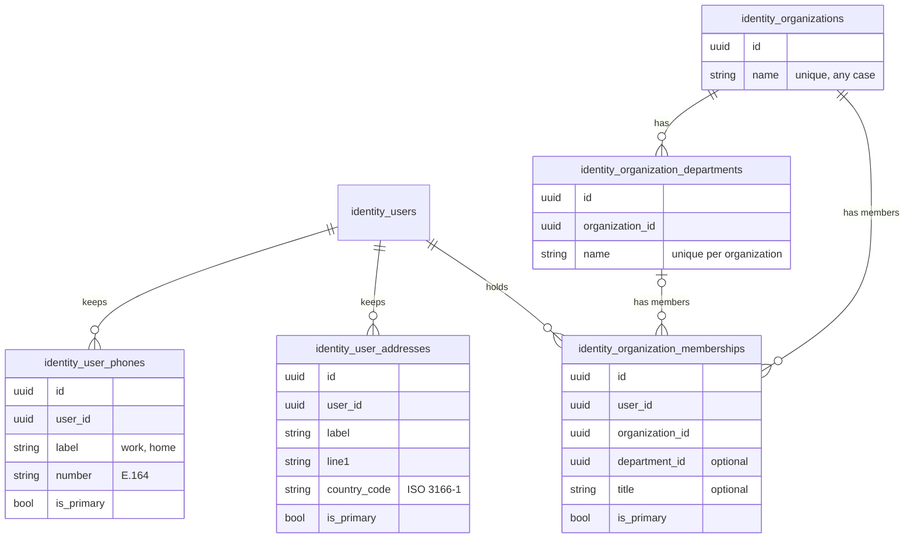

# User profiles and organizations

A z-auth user needs nothing more than an email address, and everything else about them is optional. This guide covers the optional data a user may add to their account beyond the name fields of the user row itself: any number of labelled phone numbers, any number of labelled postal addresses, and memberships in organizations and their departments. It explains how each kind of data is validated and stored, how a user marks one item of each kind as primary, how the shared organization catalog differs from the per-user data, what happens when a user, an organization or a department is deleted, and how to enable the stores behind all of it. None of this data is read at login or carried in tokens, so a deployment that never enables it behaves exactly as before.

## What a user may keep

The data falls into two groups that are enabled separately. The first group is the user's own profile: phone numbers and addresses that belong to one user, that nobody else can see through the user-facing API, and that disappear with the user. The second group is the organization catalog, a list of organizations and their departments that administrators maintain and that every user shares, together with the memberships that tie a user to an organization and, optionally, to one of its departments. A membership also carries the user's job title in that organization.



## Enabling it

Each group has its own optional store. `ProfileRepository` keeps phones and addresses, and `OrganizationRepository` keeps the catalog and the memberships. The host passes them to `ZAuthBuilder::profiles` and `ZAuthBuilder::organizations`, and may enable either one without the other. `ZAuth::profiles()` and `ZAuth::organizations()` return the services, and without the matching store every call on them fails with `AuthError::Config`.

```rust
let auth = ZAuth::builder(config, z_auth_postgres::repositories(&pool))
    .profiles(Arc::new(PgProfileRepository::new(pool.clone())))
    .organizations(Arc::new(PgOrganizationRepository::new(pool.clone())))
    .build()?;
```

The PostgreSQL adapter implements both stores behind its `profile` feature, with a migration set of their own that `run_profile_migrations` or `setup_db --profile` applies and that needs PostgreSQL 15 or later. The in-memory test store implements them too, and `z_auth_testkit::profile_server` builds a test server with both wired in. The [storage ports guide](storage-ports.md) gives the contracts for writing another adapter.

## Phones and addresses

A phone number has a label and a number. The label is free text that the user chooses, such as `work`, `home` or `summer house`, trimmed and between 1 and 32 characters long, and it keeps the case the user typed. The number must be written in international form with its country code, because z-auth cannot guess a country, but it may contain the spaces, dashes, dots and parentheses that people use to make numbers readable. The service strips those and stores the number in E.164 form, a plus sign followed by 7 to 15 digits of which the first is not zero, so `+1 (555) 123-4567` is stored as `+15551234567`. A user cannot keep the same number twice, and an attempt fails with `PhoneAlreadyAdded`, while two different users may share a number, as colleagues sharing an office line do. Profile phone numbers are not verified and have nothing to do with the destinations that z-auth-mfa sends codes to.

An address has a label with the same rules, a required first line, and an optional second line, locality (the city or town), region (the state, province or county) and postal code, followed by a required country code. The text fields are trimmed and capped at 255 characters, the postal code at 20, and an optional field that is blank after trimming is stored as absent. The country code is the two-letter ISO 3166-1 code and is stored in uppercase, so `de` becomes `DE`. z-auth checks its form but not whether the code is actually assigned.

`PhoneInput` and `AddressInput` serve for both adding and replacing, and replacing always sets every field, so a client clears an optional address field by leaving it out of the replacement. A validation failure is reported as `InvalidPhoneNumber` for a number and as `InvalidProfileData`, naming the field, for everything else.

## The primary item

Each user has at most one primary phone, one primary address and one primary membership, which an application can treat as the default contact details or the main employer. The first item of a kind that a user adds becomes primary automatically. Adding or replacing an item with `is_primary = true`, or calling `set_primary_phone`, `set_primary_address` or `set_primary_membership`, makes that item primary and clears the previous primary item in the same atomic step. `is_primary = false` never demotes an item, so a replacement that leaves the flag out keeps it as it was. Deleting the primary item does not promote another one, and the user then has no primary item of that kind until they choose one. Lists come back with the primary item first and the rest oldest first.

## Organizations and departments

Organizations form a catalog that every user shares. An organization has a name, unique regardless of case so that `Acme` and `ACME` cannot both exist, and an optional description of up to 2,000 characters. A department belongs to exactly one organization and has a name that is unique within that organization in the same case-insensitive way, so two organizations may each have a `Sales` department. The service lists organizations a page at a time ordered by name, with an optional search that matches a case-insensitive substring of the name, and lists an organization's departments by name.

Creating, renaming and deleting organizations and departments are administrative operations. z-auth does not authorize them, any more than it authorizes role management, so the host must guard the routes that expose them, typically by checking a role with the `Authorizer`. The [HTTP API guide](http-api.md) lists the administrative handlers, which take no bearer token for that reason.

## Memberships

A membership ties a user to an organization from the catalog, optionally to one of that organization's departments, and optionally records a job title. A user may hold several memberships, for instance in two organizations, or in two departments of the same one, but holds each combination of organization and department only once, and belonging to an organization as a whole, without a department, counts as one such combination. The department must belong to the membership's organization, and the service refuses a department of another organization with `DepartmentNotFound`. The PostgreSQL schema enforces the same rule with a composite foreign key, so it holds even for writers that bypass the service. Each membership comes back with the current names of its organization and department, so a client can show a user's memberships without loading the catalog, and an organization's members can be listed a page at a time, oldest first, optionally limited to one department.

Through the user-facing handlers users manage their own memberships, which suits a directory where people pick their employer from a list. A deployment in which only administrators may assign memberships simply does not mount those write routes, and calls `OrganizationService::add_membership` with the right user id from its own administrative endpoint instead.

## Limits and deletion

A user may keep at most 20 phone numbers, 20 addresses and 20 memberships (`MAX_PHONES_PER_USER`, `MAX_ADDRESSES_PER_USER` and `MAX_MEMBERSHIPS_PER_USER`), and one more fails with `ProfileLimitReached`. The limits bound what one account can store, and the core enforces them before it writes.

Deleting a user deletes their phones, addresses and memberships along with the account, which the PostgreSQL schema does with cascading foreign keys and the in-memory store mirrors. Deleting an organization deletes its departments and every membership in it. Deleting a department is gentler and keeps its members in the organization with no department, because the person still works there even though the department is gone.

## Clusters

None of the profile tables are in z-auth-cluster's change feed, because nothing in them affects tokens or sessions. In shared mode every instance reads the same database, so any instance may serve profile calls. In federation mode the data lives at the authority, like the users themselves, and the other services simply do not enable the stores.

## Errors

| Error | When |
|---|---|
| `InvalidPhoneNumber` | A number that is not in international form after removing separators |
| `InvalidProfileData` | A blank or overlong label, name, address line or title, a control character, or a malformed country code |
| `PhoneAlreadyAdded` | The user already has this number |
| `PhoneNotFound`, `AddressNotFound`, `MembershipNotFound` | No such item among the user's own, including an item that belongs to another user |
| `ProfileLimitReached` | The user already keeps the maximum number of items of this kind |
| `OrganizationAlreadyExists`, `DepartmentAlreadyExists` | The name is already taken, in any case, within its scope |
| `OrganizationNotFound`, `DepartmentNotFound` | No such catalog entry, or a department of another organization |
| `MembershipAlreadyExists` | The user already holds this organization and department |
| `UserNotFound` | The user does not exist |
| `Config` | The matching store was not given to the builder |
